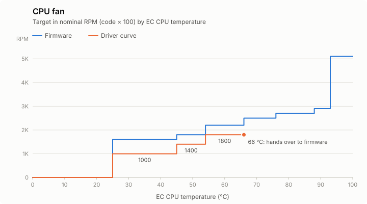
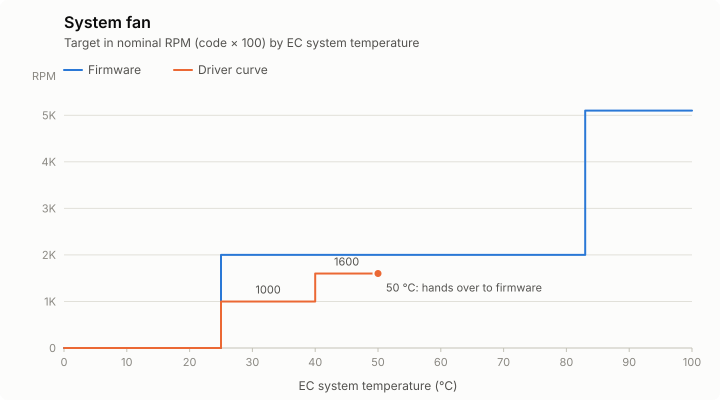

# minisforum_ec

Linux kernel module that controls both fans of the Minisforum UM760 Slim (board F7BSI, EC 0.5) through its
embedded controller. 

It shows up in `sensors` and runs its own temperature curves, with no userspace daemon.

EC access is adapted from the Windows plugin
[FanControl.MinisforumUM](https://github.com/zuyan9/FanControl.MinisforumUM) by zuyan9.

The register map, the I2EC access sequence, the identity checks and the write and restore
sequences all come from there. The module source cites the original file and line for each of them.

## Curves

The driver's default curves are tuned for silence. At low and medium temperatures they run the fans well below the
firmware's speeds, and they hand the fan back to the firmware once it gets warm, so cooling under sustained load is
the firmware's.

The firmware and the module decide on the same temperature (EC CPU or EC system). Speeds are nominal RPM
(code × 100); the measured RPM differs slightly.



| EC CPU | < 25 °C | 25–45 | 45–54 | 54–66 | 66–76 | 76–88 | 88–93 | ≥ 93 |
|---|---|---|---|---|---|---|---|---|
| Firmware | stopped | 1600 | 1800 | 2200 | 2500 | 2700 | 2900 | maximum |
| Driver | stopped | 1000 | 1400 | 1800 | firmware | firmware | firmware | firmware |



| EC system | < 25 °C | 25–40 | 40–50 | 50–83 | ≥ 83 |
|---|---|---|---|---|---|
| Firmware | stopped | 2000 | 2000 | 2000 | maximum |
| Driver | stopped | 1000 | 1600 | firmware | firmware |

- **Going down:** a step is left only 4 °C below the temperature where it starts. For example, the CPU fan
  returns to the driver at 62 °C.
- **Stepping:** the speed changes one code at a time, at most once every 4 s. Jumps make the EC's speed loop hunt.
  A stopped fan restarts at 2000 RPM and steps down from there; below 600 RPM (CPU) or 800 RPM (system) it stops.
- **Fixed limits:** whatever the curve says, the CPU fan goes to the firmware at 80 °C and the system fan at 55 °C.
  The firmware's critical row (maximum from 93 °C) is never touched.
- **Refused values:** 1–549 RPM for the CPU fan and 1–749 RPM for the system fan; other values are rounded to the
  nearest 100 (550 runs at 600). These speeds make the fan hunt or would round to a stop.
- **Hunting:** if the speed still swings by more than 600 RPM at a steady target, the fan goes to the firmware for
  60 s. After 3 times within 30 min, or 3 failed attempts to take control, it stays with the firmware
  (`pwmN_enable` reads `3`) until `pwmN_enable` is written again.
- **Firmware CPU values:** these are the bases of the BIOS-selected Balance table (Default is identical),
  without the effect of its slopes. The Performance table is faster; the table in use is logged at load.
- **Firmware system value:** 2000 RPM is measured; the table stored in the EC says 1500.

## Configuration

```sh
cat /sys/module/minisforum_ec/parameters/cpu_curve
echo "0:0,25:1000,45:1400,54:1800,66:firmware" | sudo tee /sys/module/minisforum_ec/parameters/cpu_curve
echo "0:0,25:1000,40:1600,50:firmware"         | sudo tee /sys/module/minisforum_ec/parameters/system_curve
```

To make it persistent, add `options minisforum_ec cpu_curve=... system_curve=...` to
`/etc/modprobe.d/minisforum_ec.conf`.

Each fan's mode (`pwm1` = CPU, `pwm2` = system) is set in `/sys/class/hwmon/hwmonN/`:

| `pwmN_enable` | Mode |
|---|---|
| `1` | fixed value written to `pwmN`: 0–255, where each step of 5 is 100 RPM (0 or 28–255 for `pwm1`, 0 or 38–255 for `pwm2`); returns to the curve if not renewed within 30 s |
| `2` | driver curve (default) |
| `3` | firmware |

## Installation

Requires Linux 6.17 or later. Each [release](https://github.com/mordilloSan/fan_control/releases) ships a DKMS
package for Debian/Ubuntu and a source tarball; [CHANGELOG.md](CHANGELOG.md) lists the changes per version.

```sh
sudo apt install dkms build-essential lm-sensors linux-headers-$(uname -r)
V=1.0.0
curl -LO https://github.com/mordilloSan/fan_control/releases/download/v$V/minisforum-ec-dkms_${V}_all.deb
sudo apt install ./minisforum-ec-dkms_${V}_all.deb
sensors 'minisforum_ec-*'
```

To upgrade, run the last two commands with the new version. To uninstall:

```sh
sudo apt remove minisforum-ec-dkms
```

On other distributions, with `dkms` and the kernel headers installed:

```sh
V=1.0.0
curl -L https://github.com/mordilloSan/fan_control/releases/download/v$V/minisforum-ec-$V.tar.gz | sudo tar xz -C /usr/src
sudo dkms install minisforum-ec/$V
```

The module loads automatically at boot on this board. Unloading it, suspend and shutdown all hand both fans back
to the firmware. If a fan cannot be handed back, suspend and hibernation are refused.

### Secure Boot

The module works with Secure Boot and kernel lockdown enabled: all EC access happens inside the kernel, with no
`/dev/port` or `ioperm`. It only has to be signed with a key the firmware trusts.

DKMS signs it at install time with its Machine Owner Key (MOK). On Ubuntu the key is
`/var/lib/shim-signed/mok/MOK.der`; on other distributions it is usually `/var/lib/dkms/mok.pub`. Check the
signature and whether the key is enrolled:

```sh
modinfo -F signer minisforum_ec
mokutil --sb-state
mokutil --test-key /var/lib/shim-signed/mok/MOK.der
```

If the key is not enrolled yet:

```sh
sudo mokutil --import /var/lib/shim-signed/mok/MOK.der   # asks for a one-time password
sudo reboot
```

At the next boot the blue MOK Manager screen appears. Press a key within 10 seconds, choose **Enroll MOK** →
**Continue** → **Yes**, type the password and reboot.

Until the key is enrolled, the kernel refuses to load the module (`Key was rejected by service`) and the fans stay
under firmware control.

## License

GPL-2.0, see [LICENSE](LICENSE).
